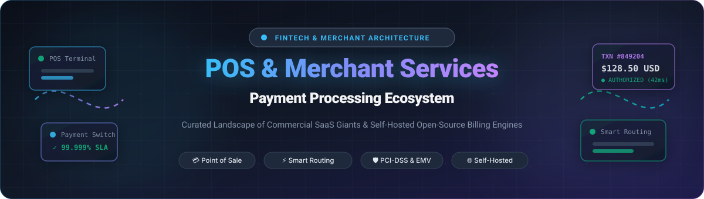

  

 

# 💳 Awesome POS, Merchant Services & Payment Processing 🚀

**Curated collection of industry-leading SaaS platforms, merchant billing architectures, and production-ready open-source Point-of-Sale (POS) & payment switch repositories.**

*Empowering retail stores, restaurants, e-commerce platforms, fintech engineers, and independent software vendors (ISVs) worldwide.*

---

## 📑 Table of Contents
- [🌐 Sector Overview & Market Dynamics](#-sector-overview--market-dynamics)
- [🏢 SaaS & Hosted Platforms](#-saashosted-platforms)
- [💻 Open-Source GitHub Projects](#-open-source-github-projects)
- [🛠️ Complementary Libraries & Toolkits](#️-complementary-libraries--toolkits)
- [🤝 How to Contribute](#-how-to-contribute)
- [💖 Support](#-support)
- [📈 Star History](#-star-history)
- [⚖️ Disclaimer & Compliance](#️-disclaimer--compliance)

---

## 🌐 Sector Overview & Market Dynamics

The global Point-of-Sale (POS) and merchant payment processing software market was valued at approximately **$29.5 billion in 2024** and is projected to surpass **$82.4 billion by 2032**, expanding at a compound annual growth rate (**CAGR**) of roughly **13.7%**. Concurrently, global digital payment transaction volume exceeded **$11.5 trillion**, propelled by contactless Tap-to-Pay, unified omnichannel commerce, and cloud-native merchant acquirers.

The sector is **moderately fragmented**: while payment acquiring infrastructure and raw processing are heavily concentrated among a handful of global mega-institutions (such as Fiserv, Stripe, Adyen, and Global Payments), the front-end software, specialized vertical POS (e.g., Toast for full-service dining, Shopify for DTC omnichannel retail, Lightspeed for specialty golf/apparel), and localized billing workflows remain broadly distributed with strong competition across vertical niches and emerging self-hosted alternatives.

---

## 🏢 SaaS/Hosted Platforms

The following table features top commercial Point-of-Sale and merchant acquiring platforms, sorted by **Company Size (Revenue / Valuation) in descending order**.

| Rank | Platform | Valuation / Revenue | Starting Price | Free Tier / Trial Limits | Key Specialization & Architecture |
|:---:|:---|:---|:---|:---|:---|
| 1 | **[Clover](https://clover.com)** (by Fiserv) | **$85B+** Market Cap (Fiserv parent, ~$19B Ann. Rev.) | **$14.95/mo** (Payments Plus SaaS) + 2.3% + 10¢ card-present transaction fees | **30-day trial** available via select merchant bank partners; requires purchasing or leasing proprietary Clover hardware. | Omnichannel smart hardware (Flex, Mini, Station) and merchant acquiring ecosystem for high-volume retail & restaurants. |
| 2 | **[Shopify POS](https://shopify.com)** | **$135B+** Market Cap (~$7.0B Ann. Rev.) | **$39/mo** (Basic Shopify plan including Shopify POS Lite) + 2.9% + 30¢ online / 2.5% in-person fees | **3-day free trial** with full platform access, followed by promotional **$1/month for the first month**; POS Pro is an optional $89/mo/location add-on. | Unified multi-store POS syncing e-commerce inventory, customer CRM, gift cards, and Tap-to-Pay card readers. |
| 3 | **[Stripe Terminal](https://stripe.com)** | **$70B+** Valuation (~$16B+ Net Revenue) | **$0/mo platform fee**; pay-per-transaction from **2.7% + 5¢** per card-present transaction | **Pay-as-you-go free tier forever** with 100% full sandbox API access, zero monthly subscriptions, and unlimited test card simulations. | Programmable hardware SDKs (iOS, Android, React Native, Server-driven) connecting pre-certified smart readers to custom POS apps. |
| 4 | **[Square POS](https://squareup.com)** (by Block, Inc.) | **$45B+** Market Cap (Block, ~$21B Gross Revenue) | **$0/mo base plan**; **2.6% + 10¢** per in-person swipe, dip, or tap transaction | **Free forever plan** with no monthly software subscription, unlimited devices, and basic inventory tracking; Square for Restaurants Plus has a **30-day free trial**. | Turnkey all-in-one cloud POS, Tap-to-Pay on iPhone/Android, kitchen display systems (KDS), invoicing, and merchant banking. |
| 5 | **[Heartland POS](https://heartland.us)** (by Global Payments) | **$30B+** Market Cap (Global Payments parent, ~$9.8B Ann. Rev.) | **$69/mo** starting POS software license per terminal + custom interchange-plus acquiring fees | **No free tier**; custom merchant demonstration and **14-day assisted pilot evaluation** arranged through enterprise sales representatives. | Robust enterprise hospitality and retail POS terminals with integrated payroll, time-clock tracking, and multi-location merchant processing. |
| 6 | **[Toast POS](https://toasttab.com)** | **$16B+** Market Cap (~$4.5B Ann. Rev.) | **$0/mo** (Quick Start Pay-As-You-Go plan at 2.99% + 15¢ processing) or standard **$69/mo** core terminal software | **$0/mo Starter plan** with single-terminal hardware financing included; paid plans offer interactive guided sandbox demo upon sales request. | Comprehensive restaurant operating system featuring rugged handheld terminals (Toast Go), KDS, online delivery dispatch, and menu engineering. |
| 7 | **[Lightspeed POS](https://lightspeedhq.com)** | **$2.5B+** Market Cap (~$900M Ann. Rev.) | **$89/mo** (Basic Retail plan billed annually) + 2.6% + 10¢ card processing | **14-day free trial** with full access to inventory management, barcode scanning, register workflows, and reporting without credit card upfront. | Advanced multi-location retail, restaurant, and golf clubhouse POS software with deep matrix inventory and supplier integrations. |
| 8 | **[Revel Systems](https://revelsystems.com)** (by Shift4) | **$1.8B** Valuation / Acquired for $250M by Shift4 (~$8B Market Cap) | **$99/mo** per terminal (billed annually, 2-terminal minimum contract) + merchant processing | **No free tier**; interactive **30-day sandbox pilot** available for qualified multi-unit franchise operators upon sales onboarding. | Enterprise-grade iPad Point-of-Sale architecture supporting high-volume quick service, franchise management, and open API connectivity. |
| 9 | **[TouchBistro](https://touchbistro.com)** | **$600M+** Valuation (~$80M Ann. Rev.) | **$69/mo** single-license iPad software + customized merchant acquiring rates | **Interactive product tour & 7-day sandbox trial** on request; live demo environment pre-populated with hospitality menu databases. | Hybrid-cloud tableside iPad POS built specifically for restaurants, bars, breweries, and food trucks with offline local network resilience. |
| 10 | **[Helcim](https://helcim.com)** | **$150M+** Estimated Valuation (~$35M Ann. Rev.) | **$0/mo software subscription**; transparent Interchange + 0.40% + 8¢ per in-person transaction | **Free forever software account** with zero monthly fees, zero cancellation fees, unlimited virtual terminals, hosted invoicing, and developer APIs. | Merchant-first transparent interchange-plus processor featuring free Point-of-Sale apps, virtual terminals, and automated rate discounts as volume scales. |

---

## 💻 Open-Source GitHub Projects

Curated list of production-grade open-source Point-of-Sale systems, self-hosted payment switches, and billing engines, sorted by **GitHub Stars in descending order**.

| Project | Stars Badge | Stargazers Link | Architecture & Stack | Primary Category & Capabilities |
|:---|:---:|:---:|:---|:---|
| **[Odoo Point of Sale](https://github.com/odoo/odoo)** |  | [View Stargazers](https://github.com/odoo/odoo/stargazers) | Python, JavaScript (OWL), PostgreSQL | Full-featured enterprise POS working 100% offline via local browser cache, automatic inventory reordering, barcode scanner support, and ledger accounting. |
| **[Hyperswitch](https://github.com/juspay/hyperswitch)** |  | [View Stargazers](https://github.com/juspay/hyperswitch/stargazers) | Rust, PostgreSQL, Redis | High-speed, mission-critical payment router & orchestration switch connecting 50+ payment gateways, smart fallback routing, card vaults, and unified merchant checkouts. |
| **[ERPNext POS](https://github.com/frappe/erpnext)** |  | [View Stargazers](https://github.com/frappe/erpnext/stargazers) | Python, Frappe Framework, MariaDB | Complete retail and wholesale Point-of-Sale module with multi-store inventory sync, customer loyalty points, GST/VAT fiscal compliance, and offline transaction queues. |
| **[Medusa](https://github.com/medusajs/medusa)** |  | [View Stargazers](https://github.com/medusajs/medusa/stargazers) | TypeScript, Node.js, PostgreSQL | Modular headless commerce engine empowering unified omnichannel retail checkouts, custom POS terminal frontends, multi-currency pricing, and extensible payment plugins. |
| **[Saleor](https://github.com/saleor/saleor)** |  | [View Stargazers](https://github.com/saleor/saleor/stargazers) | Python, GraphQL, Django, PostgreSQL | Ultra-fast headless commerce platform tailored for omnichannel retail networks, custom iPad/tablet register frontends, and multi-channel fulfillment pipelines. |
| **[Spree Commerce](https://github.com/spree/spree)** |  | [View Stargazers](https://github.com/spree/spree/stargazers) | Ruby on Rails, PostgreSQL | Open-source enterprise headless e-commerce and POS framework supporting credit card tokenization, physical gift cards, multi-store stock, and third-party gateway hooks. |
| **[Lago](https://github.com/getlago/lago)** |  | [View Stargazers](https://github.com/getlago/lago/stargazers) | Go, Ruby on Rails, PostgreSQL | Open-source metering, billing engine, and merchant subscription management platform functioning as a transparent self-hosted alternative to Stripe Billing and Chargebee. |
| **[WooCommerce](https://github.com/woocommerce/woocommerce)** |  | [View Stargazers](https://github.com/woocommerce/woocommerce/stargazers) | PHP, WordPress, MySQL | Open-source commerce suite powering thousands of retail registers via community POS plugins (e.g. WooCommerce POS) with offline register support and hardware bridges. |
| **[Invoice Ninja](https://github.com/invoiceninja/invoiceninja)** |  | [View Stargazers](https://github.com/invoiceninja/invoiceninja/stargazers) | PHP (Laravel), Flutter, MySQL | Self-hosted merchant payment gateway and billing system offering customer payment portals, QR payment links, recurring merchant invoicing, and multi-gateway capture. |
| **[Akaunting](https://github.com/akaunting/akaunting)** |  | [View Stargazers](https://github.com/akaunting/akaunting/stargazers) | PHP (Laravel), Vue.js, MySQL | Free and open-source business management and accounting software featuring integrated POS apps, merchant expense tracking, banking feeds, and client billing portals. |
| **[Crater](https://github.com/crater-invoice-inc/crater)** |  | [View Stargazers](https://github.com/crater-invoice-inc/crater/stargazers) | PHP (Laravel), Vue.js, React Native | Open-source invoicing, billing, and merchant payment suite with mobile apps for on-the-go invoicing, estimate-to-invoice flows, and payment gateway webhooks. |
| **[BTCPay Server](https://github.com/btcpayserver/btcpayserver)** |  | [View Stargazers](https://github.com/btcpayserver/btcpayserver/stargazers) | C#, ASP.NET Core, PostgreSQL | Sovereign, self-hosted cryptocurrency payment processor featuring a built-in browser-based POS terminal app, Lightning Network instant settlement, and zero intermediary fees. |
| **[Kill Bill](https://github.com/killbill/killbill)** |  | [View Stargazers](https://github.com/killbill/killbill/stargazers) | Java, OSGi, MySQL/PostgreSQL | Enterprise-grade subscription billing, invoice generation, and payment gateway routing system trusted by global telecom, cloud, and merchant processing architectures. |
| **[Solidus](https://github.com/solidusio/solidus)** |  | [View Stargazers](https://github.com/solidusio/solidus/stargazers) | Ruby on Rails, PostgreSQL | Fork of Spree Commerce designed for mission-critical e-commerce, custom point-of-sale checkout integration, omnichannel inventory, and complex merchant processing rules. |
| **[ActiveMerchant](https://github.com/activemerchant/active_merchant)** |  | [View Stargazers](https://github.com/activemerchant/active_merchant/stargazers) | Ruby | The gold-standard payment abstraction library originally developed by Shopify, unifying 140+ merchant gateways, card tokenization APIs, and refund webhooks. |
| **[Open Source Point of Sale (OSPOS)](https://github.com/opensourcepos/opensourcepos)** |  | [View Stargazers](https://github.com/opensourcepos/opensourcepos/stargazers) | PHP (CodeIgniter), Bootstrap, MySQL | Highly popular web-based Point-of-Sale system built for small retail businesses, featuring barcode scanning, item kits, customer accounts, and tax reporting. |
| **[TastyIgniter](https://github.com/tastyigniter/TastyIgniter)** |  | [View Stargazers](https://github.com/tastyigniter/TastyIgniter/stargazers) | PHP (Laravel), MySQL | Open-source restaurant management system combining digital table reservations, online food ordering, kitchen workflows, and tableside POS ticketing. |
| **[Payum](https://github.com/Payum/Payum)** |  | [View Stargazers](https://github.com/Payum/Payum/stargazers) | PHP | Flexible payment processing library for PHP applications offering a clean protocol abstraction across PayPal, Stripe, Klarna, Authorize.Net, and custom gateways. |
| **[python-escpos](https://github.com/python-escpos/python-escpos)** |  | [View Stargazers](https://github.com/python-escpos/python-escpos/stargazers) | Python | Hardware driver library for controlling ESC/POS thermal receipt printers over USB, Serial, Network/Ethernet, and Bluetooth from open-source POS registers. |
| **[Store-POS](https://github.com/tngoman/Store-POS)** |  | [View Stargazers](https://github.com/tngoman/Store-POS/stargazers) | React, Electron, Express, SQLite | Modern desktop Point-of-Sale client for retail shops with multi-terminal LAN synchronization, photo catalogs, cash drawer triggers, and receipt printing. |
| **[Lelonio Square](https://github.com/Lelonio/Square)** |  | [View Stargazers](https://github.com/Lelonio/Square/stargazers) | JavaScript, CSS, HTML | Clean, responsive open-source Point-of-Sale interface modeled after Square Register for quick in-browser checkout prototypes and merchant demonstrations. |
| **[POS-Awesome](https://github.com/ucraft-com/POS-Awesome)** |  | [View Stargazers](https://github.com/ucraft-com/POS-Awesome/stargazers) | Vue.js, Vuetify, Frappe | Advanced single-page application (SPA) Point of Sale interface for ERPNext offering rapid barcode entry, multi-currency payments, offline registers, and shortcut key bindings. |
| **[node-escpos](https://github.com/node-escpos/driver)** |  | [View Stargazers](https://github.com/node-escpos/driver/stargazers) | JavaScript, Node.js | Cross-platform Node.js driver library for manipulating ESC/POS thermal ticket and receipt printers via USB, Network, Serial, or Raw Bluetooth adapters. |

---

## 🛠️ Complementary Libraries & Toolkits

- **Receipt & Thermal Printer Drivers**:
  - `python-escpos` & `node-escpos` for USB/Serial/TCP thermal receipt paper cut and cash-drawer kick pulses.
  - `at-point-of-sale/ReceiptPrinterEncoder` for client-side JavaScript command generation across StarLine, StarPRNT, and ESC/POS.
- **Hardware Peripherals (WebHID & WebSerial)**:
  - Connect barcode scanners, weighing scales, and magnetic stripe card readers directly through modern Chromium browsers using the standard WebHID and WebSerial APIs without local driver daemons.
- **Financial Messaging & Standards**:
  - ISO 8583 message packers and unpackers for direct interchange communication with banking switches.
  - EMV TLV (Type-Length-Value) decoders for reading chip and contactless NFC card data blocks.
- **Architecture Blueprints**:
  - Combine **Hyperswitch** (gateway orchestration) + **Odoo POS** or **ERPNext** (retail ERP & checkout till) + **Lago** (metered subscription billing) for a sovereign, zero-vendor-lock-in payment processing infrastructure.

---

## 🤝 How to Contribute

We welcome contributions from merchants, developers, POS technicians, and fintech engineers! 🌟

1. **Fork the repository** to your personal GitHub account.
2. **Add or enhance entries** in `README.md`:
   - Follow the established table formatting for SaaS or Open-Source categories.
   - For SaaS tools: include starting tier pricing, free trial limits, and company valuation/revenue.
   - For Open-Source projects: provide the repository link, star badge, tech stack, and clear architectural summary.
3. **Keep descriptions objective and factual** without promotional marketing jargon.
4. **Submit a Pull Request (PR)** with a concise description of your additions.

---

## 💖 Support

If you find this repository helpful, please consider showing your support:
- ⭐ **Star** this repository to help others discover it!
- 🍴 **Fork** and contribute your insights, SaaS products, or open-source additions.
- 📢 **Share** it with fellow fintech engineers, retail operators, and payment developers.
- ☕ **Buy me a coffee**: Support ongoing curation and open-source maintenance via [GitHub Sponsors Dashboard](https://github.com/sponsors/ishandutta2007).

---

## 📈 Star History

## Star History

---

## ⚖️ Disclaimer & Compliance

- **Community Curated**: This repository is curated for educational, architectural, and evaluation purposes and does not constitute an endorsement or financial advice.
- **PCI-DSS Compliance**: Any organization storing, processing, or transmitting cardholder data must comply with the Payment Card Industry Data Security Standard (**PCI-DSS**). Always use certified P2PE (Point-to-Point Encryption) hardware, tokenized checkout iframes, or certified payment aggregator SDKs (e.g., Stripe Terminal, Square, Clover) to minimize your PCI scope (SAQ-A or SAQ-A-EP).
- **Fiscal & Tax Regulation**: Ensure your Point-of-Sale deployment conforms to regional fiscal laws (such as French NF525 certification, German TSE / KassenSichV cash register regulations, and national electronic invoicing / GST requirements).

---

**[⬆ Back to Top](#-awesome-pos-merchant-services--payment-processing-)**

Made with ❤️ for the global merchant and fintech engineering community.

